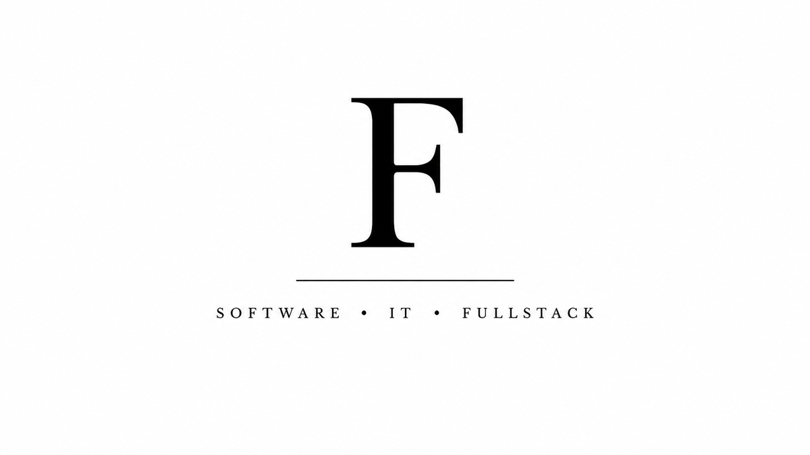
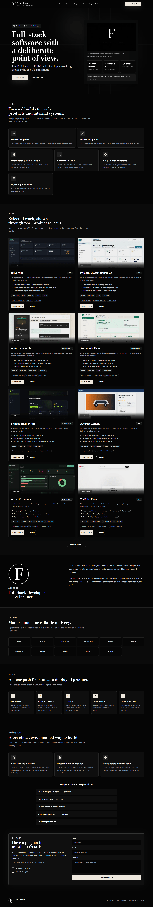

<picture>
  <source media="(prefers-color-scheme: dark)" srcset="./public/brand/tini-flegar-banner-dark.png">
  <source media="(prefers-color-scheme: light)" srcset="./public/brand/tini-flegar-banner-light.png">
  
</picture>

# Tini Flegar Portfolio

Personal portfolio for **Tini Flegar**, Full-Stack Developer · IT & Finance. The site presents selected applications, dashboards, browser extensions and engineering notes with explicit project-status labels and source links.

[Live site](https://flegartech-site-main.vercel.app) · [GitHub profile](https://github.com/flegardev) · [Email](mailto:flegardev@gmail.com)

## Features

- Personal introduction, skills, working principles and contact information
- Filter-free project index with screenshots and detailed case-study routes
- Engineering notes rendered from typed local content
- Accessible mobile navigation and keyboard-operated screenshot dialog
- Server Action contact form with validation, honeypot protection, timeout handling and a `mailto:` fallback
- Generated sitemap, robots rules, web manifest, icons and Open Graph image
- Security headers, including a staged report-only Content Security Policy
- Optimized Bodoni Moda, Cormorant Garamond and Geist typography through `next/font`

## Screenshot



## Technology

- Next.js 16 App Router
- React 19 and TypeScript
- Tailwind CSS 4
- Resend HTTP API for optional email delivery
- Vercel Analytics when deployed on Vercel
- Sharp for the checked-in branding and icon preparation scripts

## Architecture

- `src/app/` contains routes, metadata generators and the contact Server Action.
- `src/components/` contains reusable page sections and interactive UI.
- `src/data/` contains typed project, post and site identity data.
- `public/projects/` contains project screenshots.
- `public/brand/` contains clean, optimized copies of the four supplied brand assets.
- `scripts/` contains deterministic brand/icon preparation utilities.

The site is statically generated where possible. Contact delivery is the only optional external-service path.

## Local development

Requirements: Node.js 22 or newer and npm.

```bash
npm ci
copy .env.example .env.local
npm run dev
```

Open `http://localhost:3000`. Real email delivery is optional; without `RESEND_API_KEY`, submitting the form opens a pre-filled email draft.

## Environment variables

| Variable | Required | Purpose |
|---|---|---|
| `NEXT_PUBLIC_SITE_URL` | Production | Canonical URL for metadata, sitemap, robots and JSON-LD |
| `RESEND_API_KEY` | No | Server-only API key for direct contact-form delivery |
| `CONTACT_FROM_EMAIL` | No | Verified Resend sender; defaults to the Resend onboarding sender |
| `CONTACT_TO_EMAIL` | No | Recipient; defaults to `flegardev@gmail.com` |

Never expose the Resend key through a `NEXT_PUBLIC_` variable.

## Commands

| Command | Purpose |
|---|---|
| `npm run dev` | Start the development server |
| `npm run lint` | Run ESLint and Next.js web-vitals rules |
| `npm run typecheck` | Run strict TypeScript checking without emitting files |
| `npm run build` | Create the production build |
| `npm start` | Serve the production build |
| `npm audit --audit-level=high` | Fail on high/critical dependency advisories |
| `node scripts/generate-icons.mjs` | Regenerate app and manifest icons from the optimized profile asset |

To reproduce the optimized brand files, pass the four original PNG paths in light-banner, dark-banner, light-profile, dark-profile order:

```bash
node scripts/prepare-brand-assets.mjs <light-banner> <dark-banner> <light-profile> <dark-profile>
```

The originals are intentionally kept outside the repository.

## Verification

CI runs:

```bash
npm ci
npm audit --audit-level=high
npm run lint
npm run typecheck
npm run build
```

Browser verification should cover `/`, `/projects`, a project detail, `/blog`, a blog detail, mobile navigation, the screenshot dialog, the unconfigured contact fallback, `/sitemap.xml`, `/robots.txt`, `/manifest.webmanifest` and `/opengraph-image`.

## Deployment

The repository is configured for Vercel's standard Next.js runtime. See [DEPLOYMENT.md](./DEPLOYMENT.md) for environment variables, verification routes and security limitations.

## Current status and limitations

- The public portfolio URL is live; this upgrade branch does not auto-deploy or merge itself.
- Direct contact delivery requires a valid Resend key and verified sender.
- Durable contact-form rate limiting requires Vercel Firewall or another shared service; an in-memory serverless counter is intentionally not used.
- The Content Security Policy is report-only until production telemetry confirms a blocking policy will not break Next.js or Analytics.
- Project descriptions are portfolio summaries; each linked repository remains the source of truth for its current build and test state.

## Future improvements

- Promote the CSP from report-only after reviewing production violations.
- Add durable contact-rate controls at the hosting edge.
- Add automated browser accessibility checks to CI when the suite can remain stable and maintainable.

## License status

No license file is currently included. Copyright remains with Tini Flegar; no reuse license is granted by default.

## Author

<picture>
  <source media="(prefers-color-scheme: dark)" srcset="./public/brand/tini-flegar-profile-dark.png">
  <source media="(prefers-color-scheme: light)" srcset="./public/brand/tini-flegar-profile-light.png">
  
</picture>

**Tini Flegar**

Full-Stack Developer · IT & Finance

[flegardev@gmail.com](mailto:flegardev@gmail.com)
